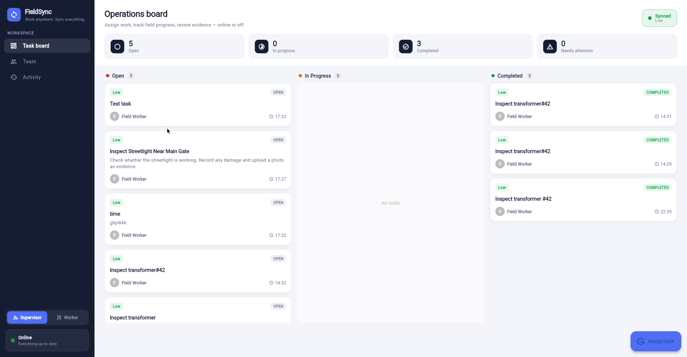
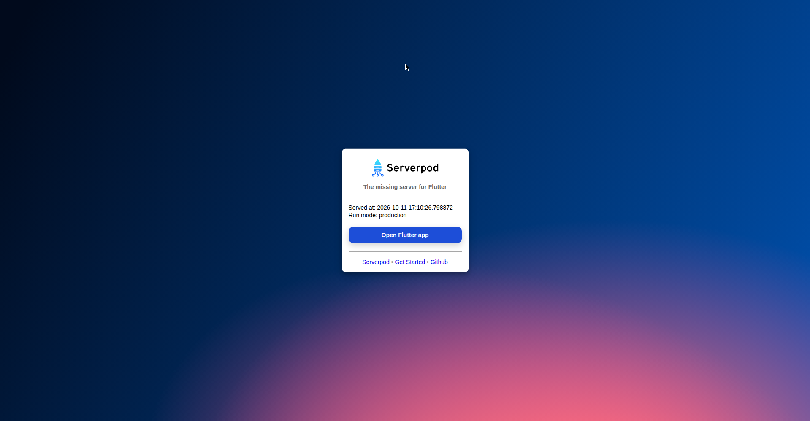

# FieldSync

**Work anywhere. Sync everything.**

FieldSync is an offline-first maintenance coordination app for field teams. Supervisors assign inspection and repair tasks; technicians keep working with zero connectivity — updating status, adding notes, capturing photo evidence — and everything synchronizes automatically when they're back online.

Built for the [Build Something Real: The Serverpod Hackathon](https://builderbase.com/event/build-something-real-the-serverpod-hackathon).

## Screenshots

### Kanban Board


### Evidence Timeline


---


## Why it exists

Field workers don't stop working when the internet does. In factories, rural sites, basements, and remote installations, connectivity is a luxury — but the job isn't. FieldSync treats offline as the normal case, not the exception: every task, note, and status change is written to a local CRDT-backed database first, then merged with the team when a connection returns. No spinners, no "retry" buttons, no lost work.

## What it does

- **Supervisor view** — assign tasks with notes and an escalation deadline
- **Worker view** — start/complete tasks, add field notes, attach photo evidence
- **Offline-first sync** — full read/write offline via CRDT merge; pending-change badge shows exactly what's queued
- **Evidence timeline** — every assignment, note, photo, and status change on a per-task timeline
- **Escalation** — tasks untouched past their deadline are auto-escalated server-side (works even if every client is offline)
- **Live sync badge** — Offline / Syncing / Pending / Synced states, always visible

## Tech stack

- **Serverpod 4** — backend, ORM, auth-ready endpoints, future calls
- **serverpod_offline_sync 0.0.10** (experimental) — CRDT-based offline sync (`database: sync` tables, shared team spaces)
- **Flutter (web)** — supervisor/worker board
- **PostgreSQL** (embedded, via `serverpod start`) — no Docker needed for local dev

Serverpod isn't glue here — it's the product. The offline merge engine, the shared-space model, the server-side escalation timer, and the generated type-safe client are all Serverpod. Without it, FieldSync is a todo list.

## Run it locally

Prerequisites: Flutter SDK, Dart, Serverpod CLI 4.x.

```powershell
# 1. Install dependencies
cd D:\fieldsync\fieldsync_flutter; flutter pub get

# 2. Generate code and create the migration (from the project root)
cd D:\fieldsync; serverpod generate
serverpod create-migration

# 3. Start everything (server + embedded Postgres + Flutter web)
serverpod start
```

Open the "Fieldsync app running at" URL from the log. No `config/passwords.yaml`? Create one:

```yaml
# D:\fieldsync\fieldsync_server\config\passwords.yaml
development:
  database: 'pick-a-local-password'
```

## The 2-minute demo

1. As **Supervisor**, assign "Inspect transformer #42" with a 2-minute escalation deadline.
2. Switch to **Worker**, open the task: Start work → add note "Voltage: 231V" → attach a photo → Complete.
3. **Turn off WiFi.** Keep working — update another task, add a note. The badge goes red: "N changes pending".
4. **Reconnect.** The badge goes amber (Syncing…), then green (Synced). The supervisor sees everything, including the photo.
5. Assign a task and *don't touch it* — after the deadline it escalates to `escalated` with a timeline entry, entirely server-side.

## Project structure

```
fieldsync_server/
  lib/server.dart                  # sync engine wiring (databaseInterceptor + initializeOfflineSync)
  lib/src/models/                  # Task, TaskEvent (database: sync), AppConfig, sync payloads
  lib/src/endpoints/               # setup (team-space bootstrap), task (assign, photo upload)
  lib/src/future_calls/            # escalation timer
  config/generator.yaml            # offline_sync module + databaseSync experimental flag
fieldsync_flutter/
  lib/src/screens/board_screen.dart
  lib/src/sync/sync_service.dart    # sync session, team-space reads/writes, reconnect flush
  lib/src/widgets/sync_badge.dart
```

## AI disclosure

Per the hackathon rules: this project was built with AI assistance (code generation, API research against the `serverpod_offline_sync` 0.0.10 sources, and debugging). The product decisions, testing, demo, and submission are the team's own work.

## Team

Arya Yaligar + teammate — 2-member team.
